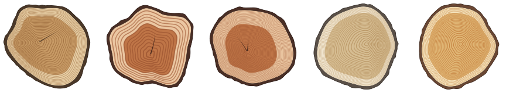
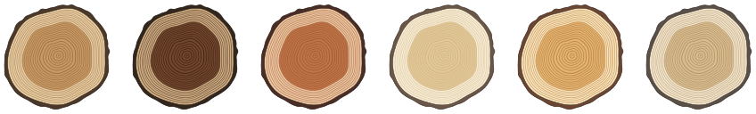
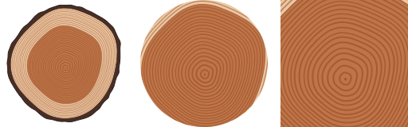

# endgrain

Identicons that grow. Every string becomes a tree, and the picture is the cut through its trunk:
growth rings, heartwood and sapwood, bark, and the occasional drying crack.



```js
import { endgrain } from 'endgrain'

endgrain('ada')                          // '<svg …>' — a log, 256 px
endgrain('ada', { shape: 'circle', size: 64 })
```

Same string, same tree, on every machine. No dependencies. Runs in Node and in the browser.

## How a tree grows

Nothing here is drawn on top of a circle and wobbled. Each tree is grown one year at a time:

- **Climate.** Ring width follows a slow random walk, so good and bad years come in runs,
  the way they do in real cores. Rings also narrow as the trunk gets wider.
- **Lean.** Trees that lean lay down more wood on one side. Each seed picks a direction and
  how hard it leaned, so the pith usually sits off-centre.
- **Shape.** A few low harmonics give the trunk its lumps. They drift a little each year,
  so the outline at the bark is related to, but not the same as, the one near the pith.
- **Rings never cross.** Growth is added per direction, always positive, so the result is
  physically possible. There is a test for it.
- **Heartwood, bark, checks.** The inner years darken into heartwood; a ragged bark closes it;
  some trees crack from the pith, and some split in from the bark.

Every trait comes from its own random stream. Pin the species or the age and the rest of the
tree stays put:



## Shapes

`log` shows the whole section. `circle` and `square` zoom in until only wood fills the frame,
which reads better at avatar sizes.



## API

### `endgrain(seed, options?) → string`

| option       | default        | |
|--------------|----------------|---|
| `size`       | `256`          | width and height of the SVG |
| `shape`      | `'log'`        | `'log'`, `'circle'` or `'square'` |
| `species`    | from the seed  | `oak`, `walnut`, `cherry`, `maple`, `pine`, `ash` |
| `age`        | from the seed  | number of rings, 3 to 200 (seeds pick 14 to 45) |
| `background` | none           | any CSS color, painted behind the wood |
| `title`      | `true`         | include an accessible `<title>` describing the tree |

### `grow(seed, options?) → tree` and `render(tree, options?) → string`

`endgrain` is these two in a row. `grow` returns plain data (rings, bark, checks, species),
handy if you want to draw it some other way.

### `describe(tree) → string`

> A 30-year-old cherry with one heart check.

This is also what goes into the SVG's `<title>`, so screen readers get something better than
"avatar".

## Command line

```
npx endgrain quietwright > quietwright.svg
npx endgrain ada --shape circle --size 64 -o ada.svg
npx endgrain ada --describe
```

## Demo

Open [`demo.html`](demo.html) straight from disk. It's one file with the library inlined and
needs no network. `npm run demo` rebuilds it from `src/`.

## Notes

- Output is around 25–45 KB of SVG, most of it ring paths. It gzips to about a third.
  If you serve many at once, cache them; they never change.
- The look is pinned by a test. A change to how trees grow is a minor version bump,
  because it changes everyone's avatar.

## License

MIT
